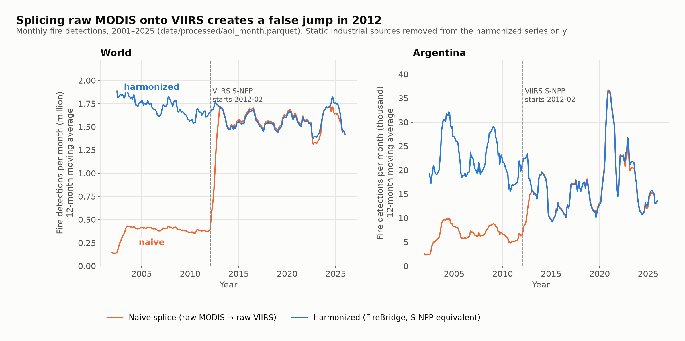
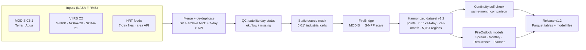
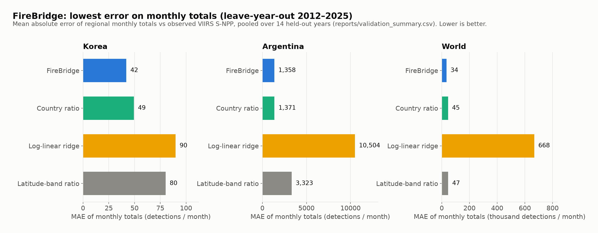
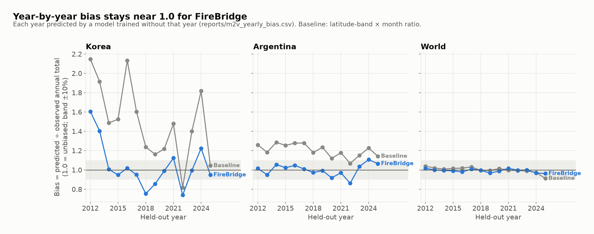
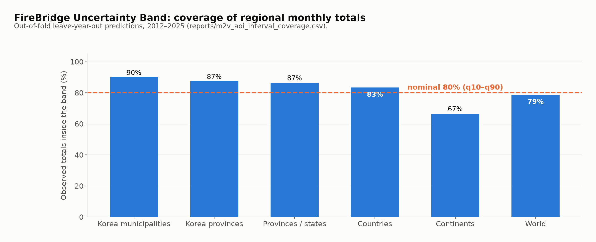
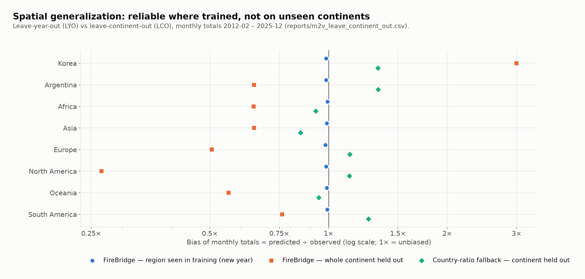
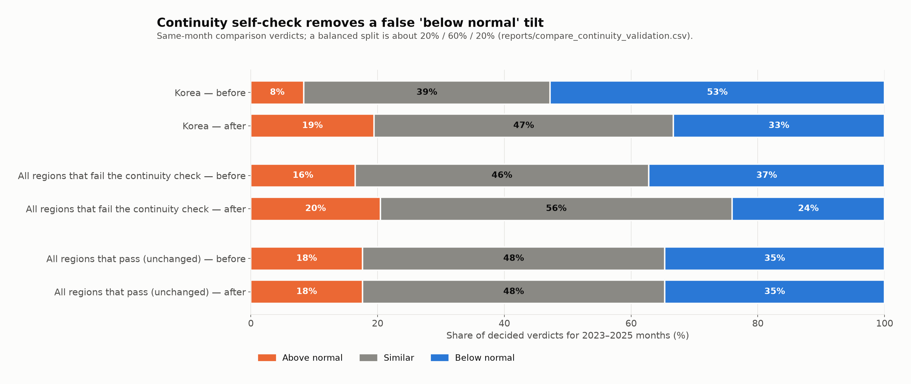
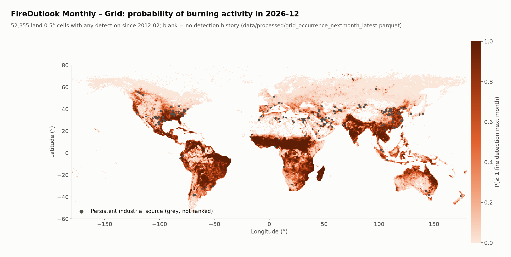
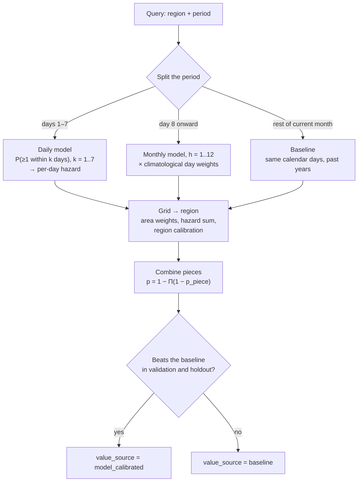
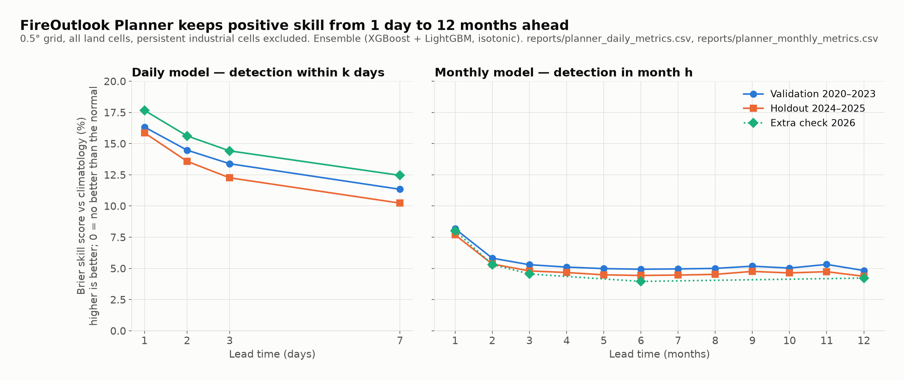

# Planetarium-AI — one continuous fire record from MODIS and VIIRS

**A harmonized, gap-free record of satellite fire detections from 2000 to today, put on one sensor scale (VIIRS S-NPP),
with validated outlooks of burning activity from tomorrow to 12 months ahead.**

[](https://github.com/Nasa-Planetarium/Planetarium-AI/releases/tag/data-v1.2-2026-11-15)

**[Web app](https://emberline-9sd.pages.dev)** · **[Data release v1.2](https://github.com/Nasa-Planetarium/Planetarium-AI/releases/tag/data-v1.2-2026-11-15)** ·
**[API docs](docs/api_contract.md)** · [Release notes](docs/release_v1.2-2026-11-15.md) · [Data sources](docs/references.md)

Team Planetarium · NASA Space Apps Challenge 2026 (Seoul) · Challenge: *Harmonization of MODIS and VIIRS Hot Spots*

The data is a single 2000-11 – 2026-11 series of **fire detections and burning activity** for 5,051 regions and every 0.1° cell on Earth.
It is built for **wildfire & emergency responders, land managers and scientists** who need to compare this season with the past
without being fooled by a change of satellite. This README covers the dataset, the models and the algorithms; the service is at the
**[web app](https://emberline-9sd.pages.dev)**.

---

## Contents

1. [The problem](#1-the-problem)
2. [What we built](#2-what-we-built)
3. [Harmonized dataset v1.2](#3-harmonized-dataset-v12)
4. [FireBridge — MODIS-to-VIIRS harmonizer](#4-firebridge--modis-to-viirs-harmonizer)
5. [Continuity self-check](#5-continuity-self-check)
6. [FireOutlook — forecasts of burning activity](#6-fireoutlook--forecasts-of-burning-activity)
7. [Validation philosophy](#7-validation-philosophy)
8. [How to use](#8-how-to-use)
9. [Limitations & future work](#9-limitations--future-work)
10. [Team, AI use, credits, references](#10-team-ai-use-credits-references)

---

## 1. The problem

MODIS (Terra and Aqua) sees fire at 1 km resolution. VIIRS (S-NPP from 2012, then NOAA-20 and NOAA-21) sees it at 375 m and records many
more detections of the same fires. Every year from 2012 to 2025, S-NPP recorded about 6–7 times as many detection points worldwide as
Aqua (`reports/aqua_snpp_overlap.csv`). **If you simply join the MODIS record to the VIIRS record, burning activity appears to jump in
2012**, and every comparison with "a normal year" before 2012 is wrong.



*Orange: raw MODIS counts until 2012-01, then raw VIIRS counts. Blue: our harmonized series, with MODIS converted to the VIIRS S-NPP
scale by FireBridge. After 2012 the two lines coincide by construction, because VIIRS is observed. The harmonized series also excludes
static industrial heat sources, so it runs slightly below raw VIIRS.*

## 2. What we built

| Component | What it does | Method | Key result (source) |
|---|---|---|---|
| **Harmonized dataset v1.2** | One series of fire detections on the VIIRS S-NPP scale, 2000-11 – 2026-11, for 0.1° cells × day / month and 5,051 regions | MODIS converted by FireBridge; S-NPP observed; NOAA-20 bridged after S-NPP data ended; static sources removed | Points → cells → regions reconcile with **0 mismatches** for every year 2000–2026 (`reports/hotspots_verify_*.csv`) |
| **FireBridge** (`m2v_xgb`) | Converts MODIS detections to what VIIRS S-NPP would have seen | XGBoost, Tweedie objective (power 1.1), 24 MODIS-only features, plus a quantile band | Korea monthly MAE **80.2 → 42.1**, bias **1.395 → 0.986** vs the latitude-band baseline (`models/m2v_meta.json`) |
| **FireOutlook Spread** (`spread_nowcast`) | Probability that a 0.025° cell near today's fire has a detection tomorrow (Korea, Argentina) | XGBoost on fire features, validated with the operational weather delay | PR-AUC about **5×** (Korea) and **3.3×** (Argentina) that of the persistence rule (`docs/backend-quickstart.md`) |
| **FireOutlook Monthly – District** (`aoi_occurrence`) | P(≥ 1 detection next month) for 252 Korean municipalities | XGBoost + Platt calibration | Model PR-AUC **0.422** vs same-month-rate baseline 0.404 (base rate 0.130); Brier 0.0927 vs 0.0964 (`reports/occurrence_metrics.csv`) |
| **FireOutlook Monthly – Grid** (`grid_occurrence`) | P(≥ 1 detection next month) for 52,855 land 0.5° cells | XGBoost + isotonic calibration | Model PR-AUC **0.900** vs same-month-rate baseline 0.869 (base rate 0.353); Brier 0.096 vs 0.104 (`reports/grid_occurrence_metrics.csv`) |
| **FireOutlook Recurrence** (`recurrence_nextmonth`) | Argentina: probability of burning activity next month | XGBoost | Model PR-AUC **0.570** vs recurrence-rate baseline 0.494 (base rate 0.075), static-source cells excluded (`reports/recurrence_metrics_no_static.csv`) |
| **FireOutlook Planner** (`planner_*`) | Any region (aoi_id, bbox, polygon) × any period, 1 day – 12 months ahead | Direct multi-horizon XGBoost + LightGBM ensemble, isotonic calibration, hazard aggregation | Holdout Brier skill vs climatology **+15.9%** at 1 day, **+5.4%** at 2 months (`reports/planner_daily_metrics.csv`, `reports/planner_monthly_metrics.csv`) |
| **Continuity self-check** | Chooses each region's baseline period for "above / similar / below normal" | Harmonized change vs raw-MODIS change, 2003–2011 → 2013–2021 | Korea's "below normal" share in 2023–2025: **53% → 33%** (`reports/compare_continuity_validation.csv`) |
| **QC rules** | Daily data status per satellite; flags missing and low-coverage days | 30-day median baseline, cross-satellite check, known outages | Months with < 50% usable days are left out of training (`reports/train_excluded_months.csv`) |
| **Static-source exclusion** | Removes steel works, refineries, gas flares and similar sources from all totals | 0.01° cells where FIRMS reported non-vegetation `type` 1 or 2 in ≥ 2 years | Korea 2012-02 – 2026-11 total **−22.7%**, world −1.1% (`reports/static_exclusion_before_after_totals.csv`) |



## 3. Harmonized dataset v1.2

| Property | Value |
|---|---|
| Period | 2000-11 – 2026-11 (the current month is marked `partial`) |
| Scale | VIIRS S-NPP-equivalent detection counts (`value`) with a 10–90% band (`value_lo`, `value_hi`) |
| Spatial units | 0.1° cells worldwide; 5,051 regions: world, 8 continents, 248 countries, 4,524 first-level divisions, Korea, 17 Korean provinces, 252 Korean municipalities (`aoi_list.parquet`) |
| Tables | `harmonized_cell_day` (212,790,231 rows), `harmonized_cell_month` (51,565,721), `aoi_month` (1,580,963), point files with per-point weights (`release_manifest.csv`) |
| Points | 321,562,117 reference detections counted in the cell-day table (`docs/release_v1.2-2026-11-15.md`) |
| Sources by period (`value_source`) | `modis_m2v_terra` 2000-11 – 2002-06 · `modis_m2v` 2002-07 – 2012-01 · `snpp_observed` 2012-02 – 2026-11-02 · `n20_bridge` from 2026-11-03 |
| Static-source exclusion | Points inside 0.01° cells where FIRMS standard processing reported `type` 1 or 2 in at least two years are removed from all totals |

**Main columns of `aoi_month`** (the same columns exist per cell in `harmonized_cell_month`):

| Column | Meaning |
|---|---|
| `aoi_id`, `year`, `month` | Region and month |
| `value`, `value_lo`, `value_hi` | S-NPP-equivalent fire detections and their 10–90% band |
| `value_projected`, `as_of_date` | For the month in progress: month-end estimate and last observed date |
| `raw_modis`, `raw_viirs` | Original detection counts, for reference |
| `value_source` | Sensor and method that produced `value` (see above) |
| `data_source`, `status` | `SP` / `NRT`; `ok`, `nrt`, `partial`, `missing` |
| `n_cells` | Number of 0.1° cells in the region |

`aoi_month_compare` adds `percentile`, `ratio_to_median`, `verdict` (above / similar / below / uncertain), `baseline_median`,
`baseline_p25`, `baseline_p75`, `baseline_period` and `continuity_ratio`. Full schemas: [API docs](docs/api_contract.md).

**QC rules.** Each satellite gets a daily status from its detections in a fixed East Asia box. A day is `missing` if it has no data or is a
known outage. It is `low` if detections fall below 50% of the previous 30-day median **while the other satellites look normal on the same
day**; a drop shared by all satellites is real weather or fire activity, not a data problem. Training uses only months in which Aqua, Terra
and S-NPP all have usable data on at least 50% of days. Full rules: [developer guide](docs/developer-guide.md).

**Consistency check.** Point weights + residual = cell value, cell sums = region totals, and daily sums = monthly totals:
0 mismatches for every year 2000–2026 (`reports/hotspots_verify_aoi_month.csv`, `reports/hotspots_verify_cell_month.csv`).

## 4. FireBridge — MODIS-to-VIIRS harmonizer

**Target.** S-NPP detections per 0.1° cell and month, 2012-02 – 2025-12. They are counted on days when Aqua, Terra and S-NPP all have
usable data, then scaled to the full month.

**Inputs (MODIS only, no VIIRS information).** For Aqua and Terra each: detections, active days, confident detections, FRP sum and
maximum, night share, detections in the 3×3 neighbourhood and observed days. Also Terra orbit drift, month (sin/cos), cell latitude and
longitude, and country, UN subregion and continent as categorical features (`models/m2v_meta.json`).

| Setting | Value |
|---|---|
| Objective | Tweedie, variance power 1.1 (chosen by inner-year Poisson deviance) |
| Trees | `hist`, depth 8, learning rate 0.05, min child weight 10, subsample 0.8, colsample 0.9, λ 1.0, 2,697 rounds |
| Sample weights | Inverse sampling rate (cells with zero detections are subsampled) |
| Variants | **FireBridge-Terra** (`m2v_xgb_terra`, Terra-only inputs, used for 2000-11 – 2002-06) · **N20 Bridge** (`n20_bridge`, NOAA-20 → S-NPP ratio after S-NPP data ended on 2026-11-02) |
| Uncertainty | **FireBridge Uncertainty Band** (`m2v_q10_q90`, quantile regression) for cells; for regions, out-of-fold ratio quantiles by region type and size |

**Leave-year-out validation (LYO).** Each year from 2012 to 2025 is held out in turn, and regional monthly totals are compared with observed
S-NPP. FireBridge has the lowest error in Korea, Argentina and the world. The adoption rule was fixed in advance: FireBridge had to beat the
latitude-band baseline on both MAE and |bias − 1| for Korea.



| Region | Latitude-band ratio (MAE / bias) | Country ratio | Log-linear ridge | **FireBridge** |
|---|---|---|---|---|
| Korea | 80.2 / 1.395 | 49.4 / 0.977 | 89.9 / 1.567 | **42.1 / 0.986** |
| Argentina | 3,323 / 1.188 | 1,371 / 0.998 | 10,504 / 1.637 | **1,358 / 0.986** |
| World | 46,674 / 1.000 | 45,266 / 1.000 | 668,253 / 1.355 | **34,413 / 0.992** |

*MAE in detections per month, pooled over 14 held-out years; bias = predicted ÷ observed (`reports/validation_summary.csv`).*



**Uncertainty band.** Share of observed regional monthly totals inside the 10–90% band (target 80%; `reports/m2v_aoi_interval_coverage.csv`):

| Region group | Region-months | Coverage |
|---|---|---|
| Korean municipalities (`sgg`) | 41,580 | 90% |
| Korean provinces (`sido`) | 2,805 | 87% |
| First-level divisions (`adm1`) | 738,884 | 87% |
| Countries | 39,930 | 83% |
| **Continents** | 1,320 | **67%** |
| World | 165 | 79% |

Continents fall short because low-count continent-months (fewer than 1,000 detections, mostly Antarctica and the open ocean) are covered only 0–36% of the
time, while large continents (≥ 10,000 a month) reach 79%.



**Leave-continent-out (LCO).** We also held out whole continents. FireBridge keeps the seasonal shape (correlation 0.75–0.98) but
**not the level** on a continent it never saw: bias 0.27–0.76× for continents and 3.0× for Korea (`models/m2v_meta.json`,
`reports/m2v_leave_continent_out.csv`). All released values come from a model that saw every country, which is the LYO condition. For a
region outside the training data, the documented fallback is the country-ratio method (LCO bias 0.85–1.34).



## 5. Continuity self-check

The app labels each month "above / similar / below normal" against the same month in other years. That comparison is fair only if the
pre-2012 harmonized values are on the same footing as the VIIRS years. We test this per region:

```
continuity_ratio = (harmonized 2013–2021 ÷ harmonized 2003–2011) ÷ (raw MODIS 2013–2021 ÷ raw MODIS 2003–2011)
```

Raw MODIS is one sensor across both periods, so its change is the reference. If the harmonized change agrees within **0.85–1.15**,
the region uses the full baseline (2001–2025). Otherwise it uses only the VIIRS years (2012–2025), and its pre-2012 months are marked
`uncertain`. Regions with fewer than 50 raw MODIS detections in either period take their parent region's ratio. A month with fewer than
8 baseline years is `uncertain`.

**Result:** 3,036 regions use 2001–2025 and 2,015 use 2012–2025. Korea (0.68) fails the check; Argentina (1.05) and the world (1.02) pass.
Verdicts of passing regions do not change. In failing regions, the false tilt toward "below normal" in recent years disappears
(`reports/compare_continuity_validation.csv`, `reports/compare_continuity_ratios.csv`).



## 6. FireOutlook — forecasts of burning activity

*FireBridge harmonizes the past; FireOutlook estimates tomorrow and the months ahead.* All outlooks predict **satellite fire detections**,
not wildfire occurrence, and every model is compared with a simple baseline.

| Model | Algorithm | Target | Validation | vs baseline |
|---|---|---|---|---|
| **Spread** | XGBoost, fire features only (weather that arrives 4 days late did not help) | Detection tomorrow in a 0.025° cell within ~7.5 km of today's fire | Leave-year-out 2012–2025 | PR-AUC 0.210 (Korea), 0.190 (Argentina); about 5× / 3.3× the persistence rule |
| **Monthly – District** | XGBoost + Platt | ≥ 1 detection in a Korean municipality next month | Expanding window, test years 2016–2025 (pooled) | Model PR-AUC 0.422 vs baseline 0.404 (base rate 0.130); Brier 0.0927 vs 0.0964 |
| **Monthly – Grid** | XGBoost + isotonic | ≥ 1 detection in a 0.5° cell next month | Expanding window, test years 2020–2025 (pooled, persistent sources excluded) | Model PR-AUC 0.900 vs baseline 0.869 (base rate 0.353); Brier 0.096 vs 0.104; better on every continent |
| **Recurrence** | XGBoost | Burning activity next month in 0.025° cells (Argentina) | Expanding window, test years 2016–2025 (pooled), static-source cells excluded | Model PR-AUC 0.570 vs recurrence-rate baseline 0.494 (base rate 0.075) |
| **Planner** | XGBoost + LightGBM ensemble, isotonic; statsforecast AutoETS/AutoTheta for some regional counts | ≥ 1 detection and expected count for any region × period | Selection 2020–2023, holdout 2024–2025, extra check 2026 | See below |

*Sources: `reports/spread_ops_metrics.csv`, `docs/backend-quickstart.md`, `reports/occurrence_metrics.csv` (row `xgboost_platt`),
`reports/grid_occurrence_metrics.csv` (rows `excl_persistent, ALL`), `reports/recurrence_metrics_no_static.csv` (rows `ARG`).*



### FireOutlook Planner

The Planner answers: *"In region R between dates A and B, what is the probability of at least one fire detection, and how many are expected?"*
It combines precomputed 0.5° grid forecasts and answers a 30-day query in 0.006–0.012 s for a municipality, province, bbox or polygon, and in
0.26 s for the world (`reports/planner_30d_latency.csv`).



**Why direct multi-horizon instead of recursive forecasting.** Each lead time (1–7 days, 1–12 months) has its own model. It is trained on
that lead time's target, using only information available on the reference date. No model feeds its own predictions back in as inputs, so
errors do not compound over lead times. Each lead time also gets its own isotonic calibration and its own skill score, and can fall back to
the baseline on its own when it does not win. *(This is a design choice; the repository has no numerical comparison with a recursive model.)*



*Brier skill score of the ensemble on all 0.5° land cells. At 1 month the service uses FireOutlook Monthly – Grid, which scores about the same
(holdout Brier 0.0949 vs 0.0948, `reports/planner_grid_h1_vs_grid_occurrence.csv`).*

**Calibration and `value_source`.** Combining pieces over-predicts for regions (Korean municipalities: 0.107 predicted vs 0.066 observed).
Each unit therefore gets a skill grade from the smaller of the raw and the cross-fitted Brier skill. The rule is **"show the normal when the
model does not beat it"**. Units graded `none` return the calibrated baseline (`value_source = "baseline"`). Units graded `high` or `low` return
the isotonic-calibrated model probability (`"model_calibrated"`). 30-day holdout 2024–2025 (`reports/planner_30d_validation.csv`):

| Unit | Observed rate | BSS raw / cross-fitted | Skill | `value_source` |
|---|---|---|---|---|
| 0.5° grid cell | 0.350 | +10.1% / +8.8% | high | `model_calibrated` |
| Korean province | 0.544 | +10.6% / +6.4% | high | `model_calibrated` |
| First-level division (e.g. Argentine provinces) | 0.534 | +5.7% / +2.1% | low | `model_calibrated` |
| Korean municipality | 0.066 | +12.9% / +0.9% | none | `baseline` |
| Country | 0.741 | −1.3% / −0.7% | none | `baseline` |

After cross-fitted calibration the mean prediction matches the observed rate: grid 0.351 / 0.350, provinces 0.550 / 0.544,
first-level divisions 0.535 / 0.534, municipalities 0.068 / 0.066 (`reports/planner_30d_calibration_after.csv`).

**30-day API example** (abridged; full response and field list in the [API docs](docs/api_contract.md)):

```json
// POST /forecast {"region": "SIDO_51", "horizon_days": 30}
{"product": "FireOutlook Planner", "start": "2026-11-15", "end": "2026-12-14", "as_of": "2026-11-14",
 "p_any": 0.619, "expected_count": 1.37, "expected_count_q10": 0.0, "expected_count_q90": 3.02,
 "baseline": {"p_any": 0.5385, "count": 1.28},
 "skill": "high", "count_skill": "none", "value_source": "model_calibrated",
 "daily": [{"date": "2026-11-15", "lead_days_from_as_of": 1, "p_day": 0.0631, "base_p_day": 0.0647, "source": "daily model"}, "..."],
 "notice": "Probability of satellite fire detections; it does not guarantee that a wildfire will occur."}
```

## 7. Validation philosophy

- **Never test on what the model has seen.** FireBridge: leave-one-year-out over 14 years (2012–2025), plus leave-one-continent-out for
  spatial transfer. Forecasts: expanding window. For test year Y, models train on years ≤ Y−2 and are calibrated and early-stopped on Y−1.
- **Choose once, then confirm.** Planner models and ensembles are selected on 2020–2023 and confirmed on a 2024–2025 holdout **without
  re-selection**, with January–October 2026 as an extra check.
- **Always beat a simple baseline.** Baselines are the latitude-band and country ratios (FireBridge), the same-month rate and last year's same
  month (monthly outlooks), climatology (daily outlooks) and persistence (Spread). A model is served only where it beats the baseline in
  both validation and holdout. Otherwise the baseline is served and labelled (`value_source`, `skill`).
- **Validate under operating conditions.** Spread was validated with weather that is 4 days old, as in operations, because same-day weather
  would overstate its skill.
- **Check that the numbers add up.** Points, cells, regions, days and months reconcile exactly for 2000–2026.
- **Proper scores.** PR-AUC, Brier (skill) and reliability by decile for probabilities; MAE, bias and WAPE for counts.

## 8. How to use

**Requirements:** [uv](https://docs.astral.sh/uv/) (it installs Python and the dependencies) and the [GitHub CLI](https://cli.github.com/)
for downloads.

```bash
git clone https://github.com/Nasa-Planetarium/Planetarium-AI.git
```
```bash
cd Planetarium-AI && uv sync
```

**Get the data** (downloads, checks each file's SHA-256 against `release_manifest.csv`, unpacks):

```bash
uv run python -m planetarium.release_assets install --dest data/processed --hotspot-years 2025
```
```bash
uv run python -m planetarium.release_assets verify --dest data/processed
```

**Read it** (Polars):

```python
import polars as pl
kr = (pl.read_parquet("data/processed/aoi_month.parquet").filter(pl.col("aoi_id") == "KR")
        .join(pl.read_parquet("data/processed/aoi_month_compare.parquet")
                .select("aoi_id", "year", "month", "verdict", "baseline_period"), on=["aoi_id", "year", "month"]))
```

**Ask the Planner** (the function behind `POST /forecast`):

```bash
uv run python -m planetarium.forecast --region SIDO_51 --horizon-days 30
```

```python
from planetarium.forecast import forecast
forecast("ADM1_ARG-1299", "2026-12-01", "2026-12-31")              # Córdoba, next month
forecast((126.5, 37.0, 127.5, 38.0), "2027-03-01", "2027-03-15")   # bbox (W, S, E, N)
```

- API endpoints, fields and display rules: [docs/api_contract.md](docs/api_contract.md)
- Rebuilding the pipeline from raw FIRMS files: [docs/developer-guide.md](docs/developer-guide.md)
- README figures: `uv run python scripts/make_readme_figures.py` (after downloading the data)

Near-real-time updates use the FIRMS area API and need your own FIRMS MAP_KEY, read from an environment variable. Never put the key in code
or commit it.

## 9. Limitations & future work

- **FireBridge does not transfer to unseen continents** (Section 4). Use the country-ratio fallback outside the training data.
- **Industrial sources before 2012 are only partly removed** (Korea: 7% removed before 2012-02 vs 23% after). FireBridge and Recurrence were
  trained on data that still contained them.
- **Spread** only scores cells within about 7.5 km of today's detections (these hold 25% of tomorrow's detections in Korea and 42% in
  Argentina). It is not a physical fire-spread simulation.
- **Planner:** for large regions the probability is close to 1 and carries little information. Daily forecasts were validated on grid cells
  only, and long periods treat monthly pieces as independent.
- **Outlooks predict satellite detections**, which depend on cloud cover and overpass time. They are not official wildfire forecasts.
- Future work: region-specific FRP conversion, department-level areas for Argentina, and daily weather inputs once a timely global source is
  available.

## 10. Team, AI use, credits, references

### Team

Team Planetarium — NASA Space Apps Challenge 2026, Seoul.

- **정가현 (Gahyun Jung)** — team lead, dataset & models
- **신종훈 (Jonghun Shin)** — models

### AI use disclosure

AI coding assistants were used to help write code and documentation; all model design decisions, validation, and reported numbers were
reviewed by the team.

### Credits (Acknowledgements)

- **Jonghun Shin ([@ozingmw](https://github.com/ozingmw))**: we used the following designs from the `handoff/firms-1km-backend` branch as a
  reference and integrated them into this repository:
  - handling of FIRMS CSV and API responses (satellite code mapping, required-column checks, recording the observed range on days with zero detections)
  - installing split release files and checking their SHA-256
  - the idea of converting FRP between satellites (recomputed here on the S-NPP scale)
  - the region (bbox) query helper
- The official harmonized dataset (`value`, S-NPP scale) is based on this repository's `m2v_xgb` (FireBridge) conversion and the v1.2 Release.
  The teammate's branch is kept separately for reference.

### References

- We acknowledge the use of data from NASA's Fire Information for Resource Management System (FIRMS) (https://firms.modaps.eosdis.nasa.gov),
  part of NASA's Earth Science Data and Information System (ESDIS).
- Giglio, L., Schroeder, W., & Justice, C. O. (2016). The collection 6 MODIS active fire detection algorithm and fire products.
  *Remote Sensing of Environment*, 178, 31–41. https://doi.org/10.1016/j.rse.2016.02.054
- Schroeder, W., Oliva, P., Giglio, L., & Csiszar, I. A. (2014). The New VIIRS 375 m active fire detection data product: Algorithm description
  and initial assessment. *Remote Sensing of Environment*, 143, 85–96. https://doi.org/10.1016/j.rse.2013.12.008
- Giglio, L., Justice, C., Boschetti, L., & Roy, D. (2021). *MODIS/Terra+Aqua Burned Area Monthly L3 Global 500m SIN Grid V061*.
  NASA EOSDIS LP DAAC. https://doi.org/10.5067/MODIS/MCD64A1.061
- NASA POWER (MERRA-2, Daily 2.10.3, accessed 2026/11/14): The data was obtained from National Aeronautics and Space Administration (NASA)
  Langley Research Center's Prediction Of Worldwide Energy Resources (POWER) project funded through the NASA Earth Science Division.
- Van Wagner, C. E. (1987). *Development and structure of the Canadian Forest Fire Weather Index System*. Forestry Technical Report 35.
- Boundaries: admdongkor (CC BY 4.0), geoBoundaries, Natural Earth. Wildfire statistics: Korea Forest Service.
- Software: Polars, PyArrow, XGBoost, LightGBM, scikit-learn, statsforecast (Apache-2.0), Shapely, pyproj, uv.

Full list with licenses and access dates: [docs/references.md](docs/references.md).
